# Our Choices, Our Future

**Complete individual-action climate change game decision tree**

This is a **fully branching** narrative game. The player is an ordinary young adult, not a mayor, president, CEO, or other leader. Every decision is something one person can realistically do. Each choice leads to its own follow-up event, with **no branches merging back together**.

- **15 unique decision scenes** and **30 total choices**
- **4 decisions per playthrough**
- **16 unique endings**
- **Four stats:** Economy, Wellbeing, Environment, Social Equity

## Game setup

**Premise.** You are a young adult living in a city experiencing rising living costs, extreme heat, flooding, and unequal access to resources. Your daily choices affect your own future and the people around you.

**Starting stats:** Economy = 50, Wellbeing = 50, Environment = 50, Social Equity = 50. Stat range: 0–100.

| Stat | Meaning |
|---|---|
| Economy | Personal financial security and local economic resilience. |
| Wellbeing | Health, safety, comfort, and quality of life. |
| Environment | Personal environmental impact and health of the immediate surroundings. |
| Social Equity | Fair access to resources, opportunities, protection, and assistance in the community. |

> **Important:** Stat effects are illustrative game-balance numbers, not quantitative scientific predictions. A positive Social Equity score represents a decision that makes access or benefits more inclusive; it does not mean one person can eliminate structural inequality.

## Complete branching map

Each line from a scene leads to a **different next scene**. Every path goes through START, one of T/C, one of T1/T2/C1/C2, and one of eight final-decision scenes before reaching its own ending.

```mermaid
flowchart TD
    START["START: How Will You Get to Work?"]
    START -->|Public transit or bike| T["T: Bus Route at Risk"]
    START -->|Drive your car| C["C: Rising Fuel Costs"]
    T -->|Petition for transit| T1["T1: Dangerous Heatwave"]
    T -->|Buy used bike| T2["T2: Flooded Bike Route"]
    C -->|Carpool| C1["C1: Displaced Coworker"]
    C -->|Work overtime| C2["C2: Working in Extreme Heat"]
    T1 -->|Volunteer| T1a["T1a: Cooling Center Funding"]
    T1 -->|Stay home| T1b["T1b: Electricity Bill"]
    T2 -->|Cleanup| T2a["T2a: Rain Garden"]
    T2 -->|Buy weatherproof gear| T2b["T2b: Transport Problems"]
    C1 -->|Help evacuee| C1a["C1a: Emergency Shelter"]
    C1 -->|Keep schedule| C1b["C1b: Coworker Needs a Ride"]
    C2 -->|Request safer work| C2a["C2a: Workplace Safety"]
    C2 -->|Continue overtime| C2b["C2b: Health Scare"]
    T1a -->|Option 1| E1["E1: Community Cooling Network"]
    T1a -->|Option 2| E2["E2: A Neighborhood Lifeline"]
    T1b -->|Option 1| E3["E3: The Resilient Household"]
    T1b -->|Option 2| E4["E4: Comfort at a Cost"]
    T2a -->|Option 1| E5["E5: The Shared Green Corridor"]
    T2a -->|Option 2| E6["E6: A Greener but Unequal Street"]
    T2b -->|Option 1| E7["E7: The Safe Routes Collective"]
    T2b -->|Option 2| E8["E8: Independent but Isolated"]
    C1a -->|Option 1| E9["E9: The Mutual Aid Driver"]
    C1a -->|Option 2| E10["E10: The Flood Relief Network"]
    C1b -->|Option 1| E11["E11: The Inclusive Commute"]
    C1b -->|Option 2| E12["E12: Efficiency Over Inclusion"]
    C2a -->|Option 1| E13["E13: Workplace Heat Advocates"]
    C2a -->|Option 2| E14["E14: A Personal Recovery"]
    C2b -->|Option 1| E15["E15: A Difficult Reset"]
    C2b -->|Option 2| E16["E16: Burnout and Bills"]
```



## Full decision scenes and effects

In all tables, **Eco = Economy**, **Well = Wellbeing**, **Env = Environment**, **Eq = Social Equity**. A plus sign increases a stat; a minus sign decreases it. Effects accumulate over the four choices.

### Decision 1 — Starting choice

#### Scene `START` — How Will You Get to Work?

You recently started a new job across town. You need a reliable commute, but traffic congestion and air pollution are growing problems. You must decide how to travel each day.

| Choice | Action | Eco | Well | Env | Eq | Next |
|---|---|---:|---:|---:|---:|---|
| **T** | Use public transportation or bike | +4 | -2 | +8 | +2 | `T` |
| **C** | Drive your own car | -6 | +5 | -8 | -2 | `C` |

**Real-world links for each choice:**

- **`T` → `T` — Use public transportation or bike:** [EPA — What You Can Do to Reduce Pollution from Vehicles and Engines](https://www.epa.gov/transportation-air-pollution-and-climate-change/what-you-can-do-reduce-pollution-vehicles-and)  
  *Useful info.* Explains why biking, walking, and public transit can help reduce transportation pollution.
- **`C` → `C` — Drive your own car:** [AAA — New Vehicle Ownership Costs (2026)](https://newsroom.aaa.com/2026/09/aaa-new-vehicle-ownership-costs-hit-12863-annually/)  
  *Useful info.* Breaks down real expenses such as fuel, insurance, maintenance, and owning a car.

**Consequences:**

- **T → `T`:** You save money and reduce emissions, but travel takes longer. A few months later, your local bus route is threatened.
- **C → `C`:** Driving is convenient and saves time, but fuel and maintenance are expensive. Soon, gas prices rise sharply.

### Decision 2 — Different events based on starting choice

#### Scene `T` — Your Bus Route Is Being Cut

The transit agency announces that your bus route may be discontinued because of low ridership and financial challenges. Several elderly and low-income residents depend on it.

| Choice | Action | Eco | Well | Env | Eq | Next |
|---|---|---:|---:|---:|---:|---|
| **T1** | Help neighbors petition to save the route | -3 | +3 | +4 | +8 | `T1` |
| **T2** | Buy a used bike and change your commute | +2 | +2 | +6 | -3 | `T2` |

**Real-world links for each choice:**

- **`T1` → `T1` — Help neighbors petition to save the route:** [KPBS — South Bay bus line survives campaign to remove it (2024)](https://www.kpbs.org/news/quality-of-life/2024/03/05/just-months-after-launch-south-bay-rapid-bus-line-survives-campaign-to-get-rid-of-it)  
  *Real example.* Local residents and advocates supported keeping an important bus route; the campaign was about protecting an existing new route, not reversing a budget cut.
- **`T2` → `T2` — Buy a used bike and change your commute:** [Bicycling — How to Buy a Used Bike](https://www.bicycling.com/bikes-gear/a20008824/how-to-buy-a-used-bike/)  
  *Useful info.* Gives practical guidance on inspecting and buying a secondhand bike as a travel alternative.

**Consequences:**

- **T1 → `T1`:** Your petition helps preserve the route. Neighbors later invite you to help during a heatwave.
- **T2 → `T2`:** You become less dependent on the bus, but a severe storm soon damages your cycling route.

#### Scene `C` — Gas Prices Are Rising

Gas prices jump after supply disruptions. Commuting costs more, and your coworkers are also struggling with transportation expenses.

| Choice | Action | Eco | Well | Env | Eq | Next |
|---|---|---:|---:|---:|---:|---|
| **C1** | Start carpooling with coworkers | +5 | -1 | +5 | +4 | `C1` |
| **C2** | Work extra shifts to cover fuel costs | +5 | -7 | -4 | -2 | `C2` |

**Real-world links for each choice:**

- **`C1` → `C1` — Start carpooling with coworkers:** [U.S. Department of Energy — Ridesharing and Carsharing](https://afdc.energy.gov/conserve/ridesharing)  
  *Useful info.* Explains how shared rides can reduce fuel costs, parking needs, and traffic.
- **`C2` → `C2` — Work extra shifts to cover fuel costs:** [CDC/NIOSH — Shiftwork, Long Work Hours, and Fatigue](https://www.cdc.gov/niosh/learning/safetyculturehc/module-2/9.html)  
  *Useful info.* Provides evidence about exhaustion and health concerns from extended work hours, the trade-off behind earning extra money.

**Consequences:**

- **C1 → `C1`:** You save money by sharing rides, but one of your carpool partners is soon displaced by flooding.
- **C2 → `C2`:** Your finances improve, but extra hours leave you exhausted when dangerous summer heat arrives.

### Decision 3 — Four different events

#### Scene `T1` — A Dangerous Heatwave

Because you helped save the bus route, you know several neighbors who depend on transit. During a major heatwave, some struggle to reach cooling centers.

| Choice | Action | Eco | Well | Env | Eq | Next |
|---|---|---:|---:|---:|---:|---|
| **T1a** | Volunteer at a community cooling center | -3 | +5 | 0 | +8 | `T1a` |
| **T1b** | Stay home and focus on keeping yourself cool | -3 | +7 | -2 | -1 | `T1b` |

**Real-world links for each choice:**

- **`T1a` → `T1a` — Volunteer at a community cooling center:** [California Department of Public Health — Cooling Centers Guidance](https://www.cdph.ca.gov/Programs/EPO/Pages/Extreme%20Heat%20Pages/Cooling-Centers-Guidance-7-18-23.aspx)  
  *Useful info.* Explains how cooling centers work and why access, water, supplies, and transportation matter.
- **`T1b` → `T1b` — Stay home and focus on keeping yourself cool:** [CDC — About Heat and Your Health](https://www.cdc.gov/extreme-heat/prevention/)  
  *Useful info.* Gives practical advice for staying safe during extreme heat, including using air conditioning or finding a cooled place.

**Consequences:**

- **T1a → `T1a`:** You help residents stay safe, but the cooling center later faces a funding shortage.
- **T1b → `T1b`:** You protect your own health, but increased electricity use leads to a high utility bill.

#### Scene `T2` — The Flooded Bike Route

Heavy rain floods streets and damages your cycling route. Rainwater carries litter into drains and waterways.

| Choice | Action | Eco | Well | Env | Eq | Next |
|---|---|---:|---:|---:|---:|---|
| **T2a** | Join volunteers cleaning storm debris | -3 | +2 | +5 | +6 | `T2a` |
| **T2b** | Buy weatherproof gear and take another route | -6 | +4 | +2 | -2 | `T2b` |

**Real-world links for each choice:**

- **`T2a` → `T2a` — Join volunteers cleaning storm debris:** [NBC San Diego — Chula Vista volunteers clean up before heavy rain (2026)](https://www.nbcsandiego.com/news/local/chula-vista-volunteers-clean-up-neighborhood-ahead-of-potential-el-nino-rains/4102103/)  
  *Real example.* Volunteers removed litter and debris that otherwise could wash into drains and waterways.
- **`T2b` → `T2b` — Buy weatherproof gear and take another route:** [NHTSA — Bicycle Safety](https://www.nhtsa.gov/road-safety/bicycle-safety)  
  *Useful info.* Covers visibility, safety equipment, and planning safer bicycle trips when conditions are difficult.

**Consequences:**

- **T2a → `T2a`:** Residents propose rain gardens to reduce future flooding.
- **T2b → `T2b`:** The detour works at first, but additional road closures disrupt your commute again.

#### Scene `C1` — Your Coworker Loses Their Home

Flooding damages the apartment building where your carpool partner lives. Your coworker must find temporary housing and transportation.

| Choice | Action | Eco | Well | Env | Eq | Next |
|---|---|---:|---:|---:|---:|---|
| **C1a** | Help evacuate them and transport supplies | -5 | +3 | -2 | +8 | `C1a` |
| **C1b** | Maintain your regular carpool schedule | +4 | +3 | +2 | -3 | `C1b` |

**Real-world links for each choice:**

- **`C1a` → `C1a` — Help evacuate them and transport supplies:** [CDC — Preparing for Floods](https://www.cdc.gov/floods/safety/)  
  *Useful info.* Covers planning an evacuation and getting to safety. In real emergencies, follow official evacuation instructions and never drive through floodwater.
- **`C1b` → `C1b` — Maintain your regular carpool schedule:** [U.S. Department of Energy — Workforce Mobility](https://afdc.energy.gov/conserve/workforce-mobility)  
  *Useful info.* Describes commuting options and employer supports; useful for discussing reliability for current riders versus the needs of people left out.

**Consequences:**

- **C1a → `C1a`:** Your coworker reaches safety, but the emergency shelter lacks supplies and accessible transportation.
- **C1b → `C1b`:** Your commute remains reliable, but another struggling coworker asks to join the carpool.

#### Scene `C2` — Working Through Extreme Heat

You have worked extra hours to cover driving costs. A severe heatwave makes your job increasingly exhausting.

| Choice | Action | Eco | Well | Env | Eq | Next |
|---|---|---:|---:|---:|---:|---|
| **C2a** | Ask your employer for safer heat policies | -2 | +5 | +1 | +7 | `C2a` |
| **C2b** | Keep working overtime despite the heat | +8 | -10 | -3 | -4 | `C2b` |

**Real-world links for each choice:**

- **`C2a` → `C2a` — Ask your employer for safer heat policies:** [OSHA — Water, Rest, Shade](https://www.osha.gov/heat-exposure/water-rest-shade/)  
  *Useful info.* Explains common workplace protections against dangerous heat.
- **`C2b` → `C2b` — Keep working overtime despite the heat:** [CDC/NIOSH — Heat-Related Illnesses](https://www.cdc.gov/niosh/heat-stress/about/illnesses.html)  
  *Useful info.* Describes heat exhaustion, heat stroke, and why continuing to work while overheated can be dangerous.

**Consequences:**

- **C2a → `C2a`:** Your employer introduces breaks but reduces some paid hours. Coworkers consider seeking paid protections.
- **C2b → `C2b`:** You earn more, but exhaustion leads to a serious health scare.

### Decision 4 — Eight different final events

#### Scene `T1a` — Cooling Center Funding Crisis

The community cooling center where you volunteer is running out of funding. Residents still need support.

| Choice | Action | Eco | Well | Env | Eq | Next |
|---|---|---:|---:|---:|---:|---|
| **1** | Help collect donations and distribute free cooling kits | -4 | +3 | +1 | +7 | `E1` |
| **2** | Personally check on vulnerable neighbors | -2 | +5 | 0 | +3 | `E2` |

**Real-world links for each choice:**

- **`1` → `E1` — Help collect donations and distribute free cooling kits:** [Alchemist CDC — Community Cooling Stations](https://alchemistcdc.org/cooling/)  
  *Real example.* A real community program that raises donations for ice, water, cooling supplies, and pop-up stations.
- **`2` → `E2` — Personally check on vulnerable neighbors:** [City of San Diego — Extreme Heat Safety](https://www.sandiego.gov/climate-resilient-sd/heat)  
  *Useful info.* Encourages residents to check on seniors, family, and neighbors during extreme heat.

**Consequences:**

- **1 → `E1`:** Donation efforts keep essential supplies available.
- **2 → `E2`:** Your direct support helps individual neighbors, even as the funding problem remains.

#### Scene `T1b` — The Electricity Bill

Your summer utility bill is far higher than expected. You worry about the cost of cooling during future heatwaves.

| Choice | Action | Eco | Well | Env | Eq | Next |
|---|---|---:|---:|---:|---:|---|
| **1** | Improve insulation and use efficient cooling | -4 | +5 | +5 | 0 | `E3` |
| **2** | Continue relying heavily on air-conditioning | -7 | +6 | -6 | -2 | `E4` |

**Real-world links for each choice:**

- **`1` → `E3` — Improve insulation and use efficient cooling:** [U.S. Department of Energy — Energy Efficiency for Renters](https://www.energy.gov/save/renters)  
  *Useful info.* Shows ways to lower energy costs and improve comfort, including options for people who do not own their homes.
- **`2` → `E4` — Continue relying heavily on air-conditioning:** [U.S. Department of Energy — Home Cooling](https://www.energy.gov/home-cooling)  
  *Useful info.* Discusses the energy used for cooling and more efficient options. **Important:** Air conditioning can be life-saving during extreme heat; the trade-off is cost and energy use, not whether people deserve to stay safe.

**Consequences:**

- **1 → `E3`:** Your home becomes more energy-efficient and resilient.
- **2 → `E4`:** You stay comfortable but face high costs and a larger environmental impact.

#### Scene `T2a` — A Community Rain Garden

After the flood cleanup, neighbors propose transforming part of a damaged public space into a rain garden.

| Choice | Action | Eco | Well | Env | Eq | Next |
|---|---|---:|---:|---:|---:|---|
| **1** | Help build an accessible rain garden for everyone | -4 | +4 | +8 | +7 | `E5` |
| **2** | Focus on beautifying the area closest to your home | -2 | +4 | +5 | -2 | `E6` |

**Real-world links for each choice:**

- **`1` → `E5` — Help build an accessible rain garden for everyone:** [EPA — Types of Green Infrastructure](https://www.epa.gov/green-infrastructure/types-green-infrastructure)  
  *Useful info.* Explains how rain gardens capture runoff. The game can add inclusive paths and seating as its own accessibility design choices.
- **`2` → `E6` — Focus on beautifying the area closest to your home:** [EPA — Equitable Investment in City Greenspace](https://www.epa.gov/sciencematters/bridging-gap-equitable-investment-city-greenspace)  
  *Useful info.* Explains why the location of greening projects matters and why benefits may be uneven across neighborhoods.

**Consequences:**

- **1 → `E5`:** The public space becomes greener, safer, and accessible.
- **2 → `E6`:** Your block becomes greener while others benefit less.

#### Scene `T2b` — Another Transportation Problem

More roadwork closes your cycling detour. You need a dependable alternative.

| Choice | Action | Eco | Well | Env | Eq | Next |
|---|---|---:|---:|---:|---:|---|
| **1** | Start a shared walking and cycling buddy group | +2 | +3 | +6 | +6 | `E7` |
| **2** | Buy a secondhand gas scooter | -7 | +5 | -6 | -2 | `E8` |

**Real-world links for each choice:**

- **`1` → `E7` — Start a shared walking and cycling buddy group:** [UCLA Transportation — How You Can Build Community by Biking](https://transportation.ucla.edu/blog/how-you-can-build-community-biking)  
  *Useful info.* Suggests joining or organizing group rides and building relationships through cycling.
- **`2` → `E8` — Buy a secondhand gas scooter:** [EPA — Air Pollution Rules for Non-Electric Motorcycles](https://www.epa.gov/regulations-emissions-vehicles-and-engines/regulations-smog-soot-and-other-air-pollution-non)  
  *Useful info.* Explains why gas-powered motorized two-wheelers have exhaust emissions; actual costs and emissions depend on the scooter model.

**Consequences:**

- **1 → `E7`:** You and neighbors develop a lower-cost, lower-emission mobility network.
- **2 → `E8`:** You gain independence but add costs and emissions.

#### Scene `C1a` — The Emergency Shelter

The flood shelter is overcrowded. Some residents cannot easily access food, medicine, or transportation.

| Choice | Action | Eco | Well | Env | Eq | Next |
|---|---|---:|---:|---:|---:|---|
| **1** | Provide additional rides and deliver supplies | -5 | +3 | -3 | +9 | `E9` |
| **2** | Coordinate donations and available rides online | +1 | +4 | +2 | +7 | `E10` |

**Real-world links for each choice:**

- **`1` → `E9` — Provide additional rides and deliver supplies:** [American Red Cross — Flood Relief](https://www.redcross.org/about-us/our-work/disaster-relief/flood-relief.html)  
  *Real example / useful info.* Shows real flood-response work, including shelters and distributing cleanup supplies. Coordinate help with responders rather than entering unsafe flood zones.
- **`2` → `E10` — Coordinate donations and available rides online:** [Nieman Lab — How Recovers.org Organized Local Disaster Relief](https://www.niemanlab.org/2012/06/recovers-org-builds-a-platform-to-structure-data-to-improve-local-diaster-relief/)  
  *Real example.* Describes an online tool built to match disaster survivors, volunteers, and donors with local needs.

**Consequences:**

- **1 → `E9`:** You help flood victims reach essential resources through direct action.
- **2 → `E10`:** You connect people to helpers while limiting unnecessary travel.

#### Scene `C1b` — A Coworker Needs a Ride

A new coworker cannot afford normal transportation costs and asks to join your carpool.

| Choice | Action | Eco | Well | Env | Eq | Next |
|---|---|---:|---:|---:|---:|---|
| **1** | Offer rides and adjust the route to include them | -4 | +4 | +1 | +8 | `E11` |
| **2** | Keep the original carpool arrangements | +4 | +2 | +3 | -5 | `E12` |

**Real-world links for each choice:**

- **`1` → `E11` — Offer rides and adjust the route to include them:** [PennDOT — Car and Van Pooling](https://www.pa.gov/agencies/penndot/traveling-in-pa/ridesharing/car-and-van-pooling)  
  *Useful info.* Gives practical steps for sharing a commute, including planning routes, schedules, and riding responsibilities when someone joins.
- **`2` → `E12` — Keep the original carpool arrangements:** [Federal Highway Administration — Traveler Choices and Carpooling](https://ops.fhwa.dot.gov/publications/mitig_traf_cong/traveler_choices.htm)  
  *Useful info.* Describes typical carpools among coworkers following similar routes. Keeping the original route can be simpler for current riders, while the game highlights that it may leave someone without a ride.

**Consequences:**

- **1 → `E11`:** You extend affordable transportation to someone who needs it.
- **2 → `E12`:** The commute is convenient for existing riders, but others are left out.

#### Scene `C2a` — Fighting for Workplace Safety

Your employer has added heat breaks but cut some paid hours. Coworkers are under financial pressure.

| Choice | Action | Eco | Well | Env | Eq | Next |
|---|---|---:|---:|---:|---:|---|
| **1** | Join coworkers requesting paid heat protections | -3 | +3 | 0 | +10 | `E13` |
| **2** | Find a more flexible job and focus on recovery | -5 | +8 | +1 | 0 | `E14` |

**Real-world links for each choice:**

- **`1` → `E13` — Join coworkers requesting paid heat protections:** [OSHA — Worker Rights and Protections](https://www.osha.gov/workers)  
  *Useful info.* Covers how workers can report workplace hazards and advocate for safer conditions. Rules about paid breaks vary by jurisdiction and job.
- **`2` → `E14` — Find a more flexible job and focus on recovery:** [CDC/NIOSH — Work Scheduling and Fatigue Prevention](https://www.cdc.gov/niosh/work-hour-training-for-nurses/longhours/mod5/14.html)  
  *Useful info.* Discusses shorter shifts, flexible scheduling, recovery time, and reducing excessive overtime. The resource is aimed at healthcare workplaces but the principles illustrate the choice.

**Consequences:**

- **1 → `E13`:** You advocate for fairer conditions and shared protections.
- **2 → `E14`:** Your own situation improves while workplace inequities remain.

#### Scene `C2b` — A Serious Health Scare

Weeks of excessive overtime in extreme heat make you ill. You need to reassess your priorities.

| Choice | Action | Eco | Well | Env | Eq | Next |
|---|---|---:|---:|---:|---:|---|
| **1** | Reduce shifts and seek community support | -7 | +10 | +1 | +5 | `E15` |
| **2** | Continue overtime despite the health risks | +7 | -12 | -2 | -4 | `E16` |

**Real-world links for each choice:**

- **`1` → `E15` — Reduce shifts and seek community support:** [United Way 211 — Healthcare Expenses and Support](https://211.org/get-help/healthcare-expenses)  
  *Useful info.* Helps people find local resources for medical expenses, prescriptions, and transport to appointments; cutting work hours can also reduce income.
- **`2` → `E16` — Continue overtime despite the health risks:** [CDC/NIOSH — Fatigue and Work](https://www.cdc.gov/niosh/fatigue/about/index.html)  
  *Useful info.* Describes the safety and health risks of long shifts, hot work environments, and insufficient recovery.

**Consequences:**

- **1 → `E15`:** You prioritize your health at the cost of some income.
- **2 → `E16`:** Income rises, but your health and quality of life decline.

## All 16 endings with computed final scores

The final score for each path is calculated as **50 + the effects from all four selected actions**. Endings are tied to the actual path, not to arbitrary score thresholds. This ensures every route has a distinct conclusion.

| Ending | Title | Path | Eco | Well | Env | Eq |
|---|---|---|---:|---:|---:|---:|
| **E1** | Community Cooling Network | `START:T → T:T1 → T1:T1a → T1a:1` | 44 | 59 | 63 | 75 |
| **E2** | A Neighborhood Lifeline | `START:T → T:T1 → T1:T1a → T1a:2` | 46 | 61 | 62 | 71 |
| **E3** | The Resilient Household | `START:T → T:T1 → T1:T1b → T1b:1` | 44 | 63 | 65 | 59 |
| **E4** | Comfort at a Cost | `START:T → T:T1 → T1:T1b → T1b:2` | 41 | 64 | 54 | 57 |
| **E5** | The Shared Green Corridor | `START:T → T:T2 → T2:T2a → T2a:1` | 49 | 56 | 77 | 62 |
| **E6** | A Greener but Unequal Street | `START:T → T:T2 → T2:T2a → T2a:2` | 51 | 56 | 74 | 53 |
| **E7** | The Safe Routes Collective | `START:T → T:T2 → T2:T2b → T2b:1` | 52 | 57 | 72 | 53 |
| **E8** | Independent but Isolated | `START:T → T:T2 → T2:T2b → T2b:2` | 43 | 59 | 60 | 45 |
| **E9** | The Mutual Aid Driver | `START:C → C:C1 → C1:C1a → C1a:1` | 39 | 60 | 42 | 69 |
| **E10** | The Flood Relief Network | `START:C → C:C1 → C1:C1a → C1a:2` | 45 | 61 | 47 | 67 |
| **E11** | The Inclusive Commute | `START:C → C:C1 → C1:C1b → C1b:1` | 49 | 61 | 50 | 57 |
| **E12** | Efficiency Over Inclusion | `START:C → C:C1 → C1:C1b → C1b:2` | 57 | 59 | 52 | 44 |
| **E13** | Workplace Heat Advocates | `START:C → C:C2 → C2:C2a → C2a:1` | 44 | 56 | 39 | 63 |
| **E14** | A Personal Recovery | `START:C → C:C2 → C2:C2a → C2a:2` | 42 | 61 | 40 | 53 |
| **E15** | A Difficult Reset | `START:C → C:C2 → C2:C2b → C2b:1` | 50 | 48 | 36 | 47 |
| **E16** | Burnout and Bills | `START:C → C:C2 → C2:C2b → C2b:2` | 64 | 26 | 33 | 38 |

### Ending descriptions

- **E1 — Community Cooling Network:** Your donation efforts keep essential cooling supplies available to vulnerable residents.
- **E2 — A Neighborhood Lifeline:** Your personal support helps neighbors survive extreme heat, although the wider funding problem remains.
- **E3 — The Resilient Household:** Efficient cooling improvements reduce energy consumption and make your home better prepared.
- **E4 — Comfort at a Cost:** You stay comfortable, but energy expenses and environmental impacts increase.
- **E5 — The Shared Green Corridor:** You help restore nature while making public space safer and more accessible.
- **E6 — A Greener but Unequal Street:** Your immediate neighborhood improves, but environmental benefits are unevenly distributed.
- **E7 — The Safe Routes Collective:** You and your neighbors build safer, affordable, low-emission transportation habits.
- **E8 — Independent but Isolated:** Your scooter improves mobility, but transport costs and emissions increase.
- **E9 — The Mutual Aid Driver:** Your transportation efforts help flood victims reach safety and supplies.
- **E10 — The Flood Relief Network:** You connect people to volunteers and resources while avoiding unnecessary driving.
- **E11 — The Inclusive Commute:** Your carpool provides affordable transportation to more people in your community.
- **E12 — Efficiency Over Inclusion:** Your commute stays financially convenient, but someone in need is excluded.
- **E13 — Workplace Heat Advocates:** Your participation helps coworkers demand safer, fairer working conditions.
- **E14 — A Personal Recovery:** You find healthier work conditions, but the old workplace problems remain unresolved.
- **E15 — A Difficult Reset:** You give up some income to protect your health and seek community support.
- **E16 — Burnout and Bills:** Your income improves, but your health and quality of life decline severely.

### Example scene data (JSON)

```json
{
  "id": "T",
  "title": "Your Bus Route Is Being Cut",
  "description": "Your local bus route may close.",
  "choices": [
    {
      "text": "Help neighbors petition to save the route",
      "effects": {"economy": -3, "wellbeing": 3, "environment": 4, "socialEquity": 8},
      "nextScene": "T1"
    },
    {
      "text": "Buy a used bike and change your commute",
      "effects": {"economy": 2, "wellbeing": 2, "environment": 6, "socialEquity": -3},
      "nextScene": "T2"
    }
  ]
}
```

### Design and accessibility considerations

- Visually update the neighborhood or character after important choices (flood debris, heatwave shelters, transportation, parks, utility bills).
- Show all four meters after each choice, with readable text and symbols in addition to color.
- Present personal decisions as **trade-offs**, not moral judgments. Options such as driving or using air-conditioning may be necessities depending on ability, safety, transit access, or income.
- Keep the central message realistic: individual actions can influence personal wellbeing and mutual aid, while large-scale climate change also requires collective and systemic solutions.

## Validation

- 15 playable scenes: `START` + 2 second-stage + 4 third-stage + 8 fourth-stage.
- 30 choice branches: exactly 2 per playable scene.
- Exactly 16 terminal ending paths, each four decisions long.
- Each ending has a separately computed total based on the full path, not just the final decision.
- Every choice leads to a unique downstream scene in its own branch; no branches reconnect.
