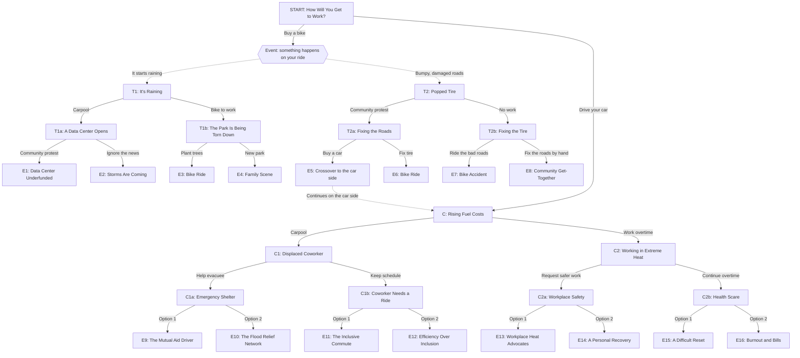

# Our Choices, Our Future

**Individual-action climate change game decision tree**

This is a branching narrative game. The player is an ordinary young adult, not a mayor, president, CEO, or other leader. Every decision is something one person can realistically do.

The tree has two sides, chosen by the first decision:

- **Bike side (left):** redesigned. There is no bus. After you buy a bike, a random event happens, and then you make two more decisions. One path (buying a car) crosses over to the car side.
- **Car side (right):** still the earlier design. It will be redesigned next.

**Four stats:** Economy, Wellbeing, Environment, Social Equity.

## Game setup

**Premise.** You are a young adult living in a city experiencing rising living costs, extreme weather, damaged roads, and unequal access to resources. Your daily choices affect your own future and the people around you.

**Starting stats:** Economy = 50, Wellbeing = 50, Environment = 50, Social Equity = 50. Stat range: 0–100.

| Stat | Meaning |
|---|---|
| Economy | Personal financial security and local economic resilience. |
| Wellbeing | Health, safety, comfort, and quality of life. |
| Environment | Personal environmental impact and health of the immediate surroundings. |
| Social Equity | Fair access to resources, opportunities, protection, and assistance in the community. |

> **Important:** Stat effects are illustrative game-balance numbers, not quantitative scientific predictions. A positive Social Equity score represents a decision that makes access or benefits more inclusive; it does not mean one person can eliminate structural inequality.

### Scenes, events, and endings

- A **scene** asks the player to choose between two options.
- An **event** is something that happens to the player. There is no choice: the game picks one outcome at random. Events have no stat effects.
- An **ending** is the final cinematic for a path. Two paths can share an ending scene (E3 and E6 both show the Bike Ride), but each path keeps its own final scores.
- A **crossover** sends the player to the other side of the tree instead of an ending (E5).

## Branching map

Solid lines are choices. Dotted lines are random events or crossovers.



## Decision scenes and effects

In all tables, **Eco = Economy**, **Well = Wellbeing**, **Env = Environment**, **Eq = Social Equity**. A plus sign increases a stat; a minus sign decreases it. Effects accumulate over the path.

### Decision 1 — Starting choice

#### Scene `START` — How Will You Get to Work?

You recently started a new job across town. You need a reliable commute, but traffic congestion and air pollution are growing problems. You must decide how to travel each day.

| Choice | Action | Eco | Well | Env | Eq | Next |
|---|---|---:|---:|---:|---:|---|
| **B** | Buy a bike | -3 | +3 | +8 | +1 | `EV` (event) |
| **C** | Drive your own car | -6 | +5 | -8 | -2 | `C` |

**Consequences:**

- **B → `EV`:** Biking is cheap to run and produces no emissions, but you are exposed to the weather and the state of the roads.
- **C → `C`:** Driving is convenient and saves time, but fuel and maintenance are expensive. Soon, gas prices rise sharply.

## Bike side (redesigned)

### Event `EV` — Something Happens on Your Ride

No choice. The game picks one outcome at random, with equal chances.

| Outcome | What happens | Next |
|---|---|---|
| **Rain** | A heavy rainstorm rolls in on your way to work. Storms like this are becoming more frequent and intense as the climate warms. | `T1` |
| **Bumpy roads** | Holes and bumpy, damaged roads make every ride rough. One day, your tire pops. | `T2` |

### Decision 2

#### Scene `T1` — It's Raining

It's pouring, and you still have to get to work.

| Choice | Action | Eco | Well | Env | Eq | Next |
|---|---|---:|---:|---:|---:|---|
| **T1a** | Carpool with a coworker | 0 | +2 | -2 | +3 | `T1a` |
| **T1b** | Bike to work anyway | +2 | -3 | +5 | 0 | `T1b` |

**Consequences:**

- **T1a → `T1a`:** You stay dry. On the drive, your coworker mentions that a huge data center is opening on the edge of town.
- **T1b → `T1b`:** You arrive soaked. On the way, you pass a sign: the city is tearing down the neighborhood park to build apartments.

#### Scene `T2` — Popped Tire

Holes in the road finally pop your bike tire. Neighbors who bike and walk deal with the same damaged roads.

| Choice | Action | Eco | Well | Env | Eq | Next |
|---|---|---:|---:|---:|---:|---|
| **T2a** | Join a community protest to get the roads fixed | -1 | +1 | +3 | +6 | `T2a` |
| **T2b** | Skip work for the day | -6 | +1 | 0 | -1 | `T2b` |

**Consequences:**

- **T2a → `T2a`:** The city agrees to repair the roads. Your bike still needs a new tire, though.
- **T2b → `T2b`:** You lose a day's pay, and your tire is still flat.

### Decision 3

#### Scene `T1a` — A Data Center Opens

A huge data center is opening nearby. It will use enormous amounts of electricity and water, much of the power from fossil fuels.

| Choice | Action | Eco | Well | Env | Eq | Next |
|---|---|---:|---:|---:|---:|---|
| **1** | Join a community protest against the data center | -2 | +2 | +8 | +7 | `E1` |
| **2** | Ignore the news | +1 | 0 | -7 | -3 | `E2` |

**Consequences:**

- **1 → `E1`:** The protest grows, and the project loses its funding.
- **2 → `E2`:** The data center opens and runs around the clock.

#### Scene `T1b` — The Park Is Being Torn Down

The city is forcing the neighborhood park to be destroyed to build new apartments. The park's trees keep the area cool and soak up rainwater.

| Choice | Action | Eco | Well | Env | Eq | Next |
|---|---|---:|---:|---:|---:|---|
| **1** | Plant trees and protect what nature you can | -1 | +4 | +7 | +5 | `E3` |
| **2** | Push for a new park in the building plans | -2 | +6 | +4 | +4 | `E4` |

**Consequences:**

- **1 → `E3`:** New trees line your street and your route to work.
- **2 → `E4`:** The plans change to include a new park.

#### Scene `T2a` — Fixing the Roads

The city is repairing the roads after the protest, but your bike still has a flat.

| Choice | Action | Eco | Well | Env | Eq | Next |
|---|---|---:|---:|---:|---:|---|
| **1** | Buy a car | -6 | +3 | -7 | -1 | `E5` (crossover) |
| **2** | Fix your tire and keep biking | -1 | +2 | +4 | +1 | `E6` |

**Consequences:**

- **1 → `E5`:** You buy a car, and the story continues on the car side of the tree.
- **2 → `E6`:** With a new tire and smooth roads, biking is easy again.

#### Scene `T2b` — Fixing the Tire

You patch the tire, but the roads are still full of holes.

| Choice | Action | Eco | Well | Env | Eq | Next |
|---|---|---:|---:|---:|---:|---|
| **1** | Keep riding on the bad roads | +1 | -6 | +2 | 0 | `E7` |
| **2** | Fix the roads by hand with your neighbors | -1 | +3 | +3 | +7 | `E8` |

**Consequences:**

- **1 → `E7`:** A hidden pothole throws you off your bike.
- **2 → `E8`:** Neighbors show up with tools, and the street turns into a gathering.

## Car side (earlier design, to be redesigned)

### Decision 2

#### Scene `C` — Gas Prices Are Rising

A hurricane shuts down Gulf Coast refineries, and gas prices spike. At the same time, wildfire smoke drifts in and the city issues air-quality alerts. Commuting costs more, and your coworkers are also struggling with transportation expenses.

| Choice | Action | Eco | Well | Env | Eq | Next |
|---|---|---:|---:|---:|---:|---|
| **C1** | Start carpooling with coworkers | +5 | -1 | +5 | +4 | `C1` |
| **C2** | Keep driving alone and take extra outdoor shifts to pay for gas | +5 | -7 | -4 | -2 | `C2` |

**Consequences:**

- **C1 → `C1`:** You save money by sharing rides, but one of your carpool partners is soon displaced by flooding.
- **C2 → `C2`:** Your finances improve, but long outdoor shifts leave you exhausted when dangerous summer heat arrives.

### Decision 3

#### Scene `C1` — Your Coworker Loses Their Home

Flooding damages the apartment building where your carpool partner lives. Your coworker must find temporary housing and transportation.

| Choice | Action | Eco | Well | Env | Eq | Next |
|---|---|---:|---:|---:|---:|---|
| **C1a** | Help evacuate them and transport supplies | -5 | +3 | -2 | +8 | `C1a` |
| **C1b** | Maintain your regular carpool schedule | +4 | +3 | +2 | -3 | `C1b` |

**Consequences:**

- **C1a → `C1a`:** Your coworker reaches safety, but the emergency shelter lacks supplies and accessible transportation.
- **C1b → `C1b`:** Your commute remains reliable, but another struggling coworker asks to join the carpool.

#### Scene `C2` — Working Through Extreme Heat

You have taken extra outdoor shifts to cover driving costs. A severe heatwave makes your job increasingly exhausting.

| Choice | Action | Eco | Well | Env | Eq | Next |
|---|---|---:|---:|---:|---:|---|
| **C2a** | Ask your employer for safer heat policies | -2 | +5 | +1 | +7 | `C2a` |
| **C2b** | Keep working overtime despite the heat | +8 | -10 | -3 | -4 | `C2b` |

**Consequences:**

- **C2a → `C2a`:** Your employer introduces breaks but reduces some paid hours. Coworkers consider seeking paid protections.
- **C2b → `C2b`:** You earn more, but exhaustion leads to a serious health scare.

### Decision 4

#### Scene `C1a` — The Emergency Shelter

The flood shelter is overcrowded. Some residents cannot easily access food, medicine, or transportation.

| Choice | Action | Eco | Well | Env | Eq | Next |
|---|---|---:|---:|---:|---:|---|
| **1** | Provide additional rides and deliver supplies | -5 | +3 | -3 | +9 | `E9` |
| **2** | Coordinate donations and available rides online | +1 | +4 | +2 | +7 | `E10` |

**Consequences:**

- **1 → `E9`:** You help flood victims reach essential resources through direct action.
- **2 → `E10`:** You connect people to helpers while limiting unnecessary travel.

#### Scene `C1b` — A Coworker Needs a Ride

A new coworker's car was ruined in the flood, and they cannot afford to replace it. They ask to join your carpool.

| Choice | Action | Eco | Well | Env | Eq | Next |
|---|---|---:|---:|---:|---:|---|
| **1** | Offer rides and adjust the route to include them | -4 | +4 | +1 | +8 | `E11` |
| **2** | Keep the original carpool arrangements | +4 | +2 | +3 | -5 | `E12` |

**Consequences:**

- **1 → `E11`:** You extend affordable transportation to someone who needs it.
- **2 → `E12`:** The commute is convenient for existing riders, but others are left out.

#### Scene `C2a` — Fighting for Workplace Safety

Your employer has added heat breaks but cut some paid hours. Coworkers are under financial pressure.

| Choice | Action | Eco | Well | Env | Eq | Next |
|---|---|---:|---:|---:|---:|---|
| **1** | Join coworkers requesting paid heat protections | -3 | +3 | 0 | +10 | `E13` |
| **2** | Find a more flexible job and focus on recovery | -5 | +8 | +1 | 0 | `E14` |

**Consequences:**

- **1 → `E13`:** You advocate for fairer conditions and shared protections.
- **2 → `E14`:** Your own situation improves while workplace inequities remain.

#### Scene `C2b` — A Serious Health Scare

Weeks of excessive overtime in extreme heat make you ill. You need to reassess your priorities.

| Choice | Action | Eco | Well | Env | Eq | Next |
|---|---|---:|---:|---:|---:|---|
| **1** | Reduce shifts and seek community support | -7 | +10 | +1 | +5 | `E15` |
| **2** | Continue overtime despite the health risks | +7 | -12 | -2 | -4 | `E16` |

**Consequences:**

- **1 → `E15`:** You prioritize your health at the cost of some income.
- **2 → `E16`:** Income rises, but your health and quality of life decline.

## Endings with computed final scores

The final score for each path is **50 + the effects from every choice on that path**. Events add nothing. Endings are tied to the path, not to score thresholds.

| Ending | Title | Path | Eco | Well | Env | Eq |
|---|---|---|---:|---:|---:|---:|
| **E1** | Data Center Underfunded | `START:B → EV:Rain → T1:T1a → T1a:1` | 45 | 57 | 64 | 61 |
| **E2** | Storms Are Coming | `START:B → EV:Rain → T1:T1a → T1a:2` | 48 | 55 | 49 | 51 |
| **E3** | Bike Ride | `START:B → EV:Rain → T1:T1b → T1b:1` | 48 | 54 | 70 | 56 |
| **E4** | Family Scene | `START:B → EV:Rain → T1:T1b → T1b:2` | 47 | 56 | 67 | 55 |
| **E5** | Crossover to the car side | `START:B → EV:Bumpy roads → T2:T2a → T2a:1` | 40 | 57 | 54 | 56 |
| **E6** | Bike Ride | `START:B → EV:Bumpy roads → T2:T2a → T2a:2` | 45 | 56 | 65 | 58 |
| **E7** | Bike Accident | `START:B → EV:Bumpy roads → T2:T2b → T2b:1` | 42 | 48 | 60 | 50 |
| **E8** | Community Get-Together | `START:B → EV:Bumpy roads → T2:T2b → T2b:2` | 40 | 57 | 61 | 57 |
| **E9** | The Mutual Aid Driver | `START:C → C:C1 → C1:C1a → C1a:1` | 39 | 60 | 42 | 69 |
| **E10** | The Flood Relief Network | `START:C → C:C1 → C1:C1a → C1a:2` | 45 | 61 | 47 | 67 |
| **E11** | The Inclusive Commute | `START:C → C:C1 → C1:C1b → C1b:1` | 49 | 61 | 50 | 57 |
| **E12** | Efficiency Over Inclusion | `START:C → C:C1 → C1:C1b → C1b:2` | 57 | 59 | 52 | 44 |
| **E13** | Workplace Heat Advocates | `START:C → C:C2 → C2:C2a → C2a:1` | 44 | 56 | 39 | 63 |
| **E14** | A Personal Recovery | `START:C → C:C2 → C2:C2a → C2a:2` | 42 | 61 | 40 | 53 |
| **E15** | A Difficult Reset | `START:C → C:C2 → C2:C2b → C2b:1` | 50 | 48 | 36 | 47 |
| **E16** | Burnout and Bills | `START:C → C:C2 → C2:C2b → C2b:2` | 64 | 26 | 33 | 38 |

E5 is not an ending. Its scores carry over as the starting stats on the car side. Where it enters the car side is still to be decided; the map shows `C` as a placeholder.

### Ending descriptions

- **E1 — Data Center Underfunded:** The protest works. The data center loses its funding, and the town's power and water stay with the people who live there.
- **E2 — Storms Are Coming:** The data center opens and burns through power day and night. Dark clouds gather as the storms keep getting worse.
- **E3 — Bike Ride:** A cinematic ride to work through the trees you helped plant.
- **E4 — Family Scene:** A cinematic scene of your family in the new park, happy and together.
- **E5 — Crossover:** You buy a car, and the story continues on the car side of the tree.
- **E6 — Bike Ride:** The same cinematic Bike Ride as E3, this time on the newly repaired roads.
- **E7 — Bike Accident:** The bad roads cause a crash. You're hurt, and the roads are still dangerous for everyone.
- **E8 — Community Get-Together:** Fixing the roads together brings the neighborhood closer.
- **E9 — The Mutual Aid Driver:** Your transportation efforts help flood victims reach safety and supplies.
- **E10 — The Flood Relief Network:** You connect people to volunteers and resources while avoiding unnecessary driving.
- **E11 — The Inclusive Commute:** Your carpool provides affordable transportation to more people in your community.
- **E12 — Efficiency Over Inclusion:** Your commute stays financially convenient, but someone in need is excluded.
- **E13 — Workplace Heat Advocates:** Your participation helps coworkers demand safer, fairer working conditions.
- **E14 — A Personal Recovery:** You find healthier work conditions, but the old workplace problems remain unresolved.
- **E15 — A Difficult Reset:** You give up some income to protect your health and seek community support.
- **E16 — Burnout and Bills:** Your income improves, but your health and quality of life decline severely.

### Example scene data (JSON)

A choice scene and an event:

```json
{
  "id": "T2",
  "title": "Popped Tire",
  "description": "Holes in the road finally pop your bike tire.",
  "choices": [
    {
      "text": "Join a community protest to get the roads fixed",
      "effects": {"economy": -1, "wellbeing": 1, "environment": 3, "socialEquity": 6},
      "nextScene": "T2a"
    },
    {
      "text": "Skip work for the day",
      "effects": {"economy": -6, "wellbeing": 1, "environment": 0, "socialEquity": -1},
      "nextScene": "T2b"
    }
  ]
}
```

```json
{
  "id": "EV",
  "type": "event",
  "outcomes": [
    {"text": "A heavy rainstorm rolls in on your way to work.", "weight": 1, "nextScene": "T1"},
    {"text": "Holes in the road make every ride rough.", "weight": 1, "nextScene": "T2"}
  ]
}
```

### Design and accessibility considerations

- Visually update the neighborhood or character after important choices (rain, damaged roads, the data center, the park, new trees).
- Show all four meters after each choice, with readable text and symbols in addition to color.
- Present personal decisions as **trade-offs**, not moral judgments. Options such as driving or skipping work may be necessities depending on ability, safety, access, or income.
- Keep the central message realistic: individual actions can influence personal wellbeing and mutual aid, while large-scale climate change also requires collective and systemic solutions.

## Validation

**Bike side**

- 1 event (`EV`) with 2 equally likely outcomes.
- 6 choice scenes: `T1`, `T2`, `T1a`, `T1b`, `T2a`, `T2b`, with exactly 2 choices each.
- 8 paths: 7 reach an ending, and 1 (E5) crosses over to the car side.
- Every bike path has 3 decisions: `START`, one of `T1`/`T2`, and one final scene.

**Car side**

- Unchanged for now: 7 scenes and 8 endings (E9–E16), each path 4 decisions long.
