# Our Choices, Our Future

**Complete individual-action climate change game decision tree**

This is a **fully branching** narrative game. The player is an ordinary young adult, not a mayor, president, CEO, or other leader. Every decision is something one person can realistically do. Each choice leads to its own follow-up event, with **no branches merging back together**.

- **15 unique decision scenes** and **30 total choices**
- **4 decisions per playthrough**
- **16 unique endings**
- **Four stats:** Economy, Wellbeing, Environment, Social Equity

## Game setup

**Premise.** You are a young adult living in a city experiencing rising living costs, extreme heat, flooding, and unequal access to resources. Your daily choices affect your own future and the people around you.

**Starting stats:** Economy = 50, Wellbeing = 50, Environment = 50, Social Equity = 50. Stat range: 0–100.

| Stat | Meaning |
|---|---|
| Economy | Personal financial security and local economic resilience. |
| Wellbeing | Health, safety, comfort, and quality of life. |
| Environment | Personal environmental impact and health of the immediate surroundings. |
| Social Equity | Fair access to resources, opportunities, protection, and assistance in the community. |

> **Important:** Stat effects are illustrative game-balance numbers, not quantitative scientific predictions. A positive Social Equity score represents a decision that makes access or benefits more inclusive; it does not mean one person can eliminate structural inequality.

## Complete branching map

Each line from a scene leads to a **different next scene**. Every path goes through START, one of T/C, one of T1/T2/C1/C2, and one of eight final-decision scenes before reaching its own ending.

```mermaid
flowchart TD
    START["START: How Will You Get to Work?"]
    START -->|Public transit or bike| T["T: Bus Route at Risk"]
    START -->|Drive your car| C["C: Rising Fuel Costs"]
    T -->|Petition for transit| T1["T1: Dangerous Heatwave"]
    T -->|Buy used bike| T2["T2: Flooded Bike Route"]
    C -->|Carpool| C1["C1: Displaced Coworker"]
    C -->|Work overtime| C2["C2: Working in Extreme Heat"]
    T1 -->|Volunteer| T1a["T1a: Cooling Center Funding"]
    T1 -->|Stay home| T1b["T1b: Electricity Bill"]
    T2 -->|Cleanup| T2a["T2a: Rain Garden"]
    T2 -->|Buy weatherproof gear| T2b["T2b: Transport Problems"]
    C1 -->|Help evacuee| C1a["C1a: Emergency Shelter"]
    C1 -->|Keep schedule| C1b["C1b: Coworker Needs a Ride"]
    C2 -->|Request safer work| C2a["C2a: Workplace Safety"]
    C2 -->|Continue overtime| C2b["C2b: Health Scare"]
    T1a -->|Option 1| E1["E1: Community Cooling Network"]
    T1a -->|Option 2| E2["E2: A Neighborhood Lifeline"]
    T1b -->|Option 1| E3["E3: The Resilient Household"]
    T1b -->|Option 2| E4["E4: Comfort at a Cost"]
    T2a -->|Option 1| E5["E5: The Shared Green Corridor"]
    T2a -->|Option 2| E6["E6: A Greener but Unequal Street"]
    T2b -->|Option 1| E7["E7: The Safe Routes Collective"]
    T2b -->|Option 2| E8["E8: Independent but Isolated"]
    C1a -->|Option 1| E9["E9: The Mutual Aid Driver"]
    C1a -->|Option 2| E10["E10: The Flood Relief Network"]
    C1b -->|Option 1| E11["E11: The Inclusive Commute"]
    C1b -->|Option 2| E12["E12: Efficiency Over Inclusion"]
    C2a -->|Option 1| E13["E13: Workplace Heat Advocates"]
    C2a -->|Option 2| E14["E14: A Personal Recovery"]
    C2b -->|Option 1| E15["E15: A Difficult Reset"]
    C2b -->|Option 2| E16["E16: Burnout and Bills"]
```

## Full decision scenes and effects

In all tables, **Eco = Economy**, **Well = Wellbeing**, **Env = Environment**, **Eq = Social Equity**. A plus sign increases a stat; a minus sign decreases it. Effects accumulate over the four choices.

### Decision 1 — Starting choice

#### Scene `START` — How Will You Get to Work?

You recently started a new job across town. You need a reliable commute, but traffic congestion and air pollution are growing problems. You must decide how to travel each day.

| Choice | Action | Eco | Well | Env | Eq | Next |
|---|---|---:|---:|---:|---:|---|
| **T** | Use public transportation or bike | +4 | -2 | +8 | +2 | `T` |
| **C** | Drive your own car | -6 | +5 | -8 | -2 | `C` |

**Consequences:**

- **T → `T`:** You save money and reduce emissions, but travel takes longer. A few months later, your local bus route is threatened.
- **C → `C`:** Driving is convenient and saves time, but fuel and maintenance are expensive. Soon, gas prices rise sharply.

### Decision 2 — Different events based on starting choice

#### Scene `T` — Your Bus Route Is Being Cut

The transit agency announces that your bus route may be discontinued because of low ridership and financial challenges. Several elderly and low-income residents depend on it.

| Choice | Action | Eco | Well | Env | Eq | Next |
|---|---|---:|---:|---:|---:|---|
| **T1** | Help neighbors petition to save the route | -3 | +3 | +4 | +8 | `T1` |
| **T2** | Buy a used bike and change your commute | +2 | +2 | +6 | -3 | `T2` |

**Consequences:**

- **T1 → `T1`:** Your petition helps preserve the route. Neighbors later invite you to help during a heatwave.
- **T2 → `T2`:** You become less dependent on the bus, but a severe storm soon damages your cycling route.

#### Scene `C` — Gas Prices Are Rising

Gas prices jump after supply disruptions. Commuting costs more, and your coworkers are also struggling with transportation expenses.

| Choice | Action | Eco | Well | Env | Eq | Next |
|---|---|---:|---:|---:|---:|---|
| **C1** | Start carpooling with coworkers | +5 | -1 | +5 | +4 | `C1` |
| **C2** | Work extra shifts to cover fuel costs | +5 | -7 | -4 | -2 | `C2` |

**Consequences:**

- **C1 → `C1`:** You save money by sharing rides, but one of your carpool partners is soon displaced by flooding.
- **C2 → `C2`:** Your finances improve, but extra hours leave you exhausted when dangerous summer heat arrives.

### Decision 3 — Four different events

#### Scene `T1` — A Dangerous Heatwave

Because you helped save the bus route, you know several neighbors who depend on transit. During a major heatwave, some struggle to reach cooling centers.

| Choice | Action | Eco | Well | Env | Eq | Next |
|---|---|---:|---:|---:|---:|---|
| **T1a** | Volunteer at a community cooling center | -3 | +5 | 0 | +8 | `T1a` |
| **T1b** | Stay home and focus on keeping yourself cool | -3 | +7 | -2 | -1 | `T1b` |

**Consequences:**

- **T1a → `T1a`:** You help residents stay safe, but the cooling center later faces a funding shortage.
- **T1b → `T1b`:** You protect your own health, but increased electricity use leads to a high utility bill.

#### Scene `T2` — The Flooded Bike Route

Heavy rain floods streets and damages your cycling route. Rainwater carries litter into drains and waterways.

| Choice | Action | Eco | Well | Env | Eq | Next |
|---|---|---:|---:|---:|---:|---|
| **T2a** | Join volunteers cleaning storm debris | -3 | +2 | +5 | +6 | `T2a` |
| **T2b** | Buy weatherproof gear and take another route | -6 | +4 | +2 | -2 | `T2b` |

**Consequences:**

- **T2a → `T2a`:** Residents propose rain gardens to reduce future flooding.
- **T2b → `T2b`:** The detour works at first, but additional road closures disrupt your commute again.

#### Scene `C1` — Your Coworker Loses Their Home

Flooding damages the apartment building where your carpool partner lives. Your coworker must find temporary housing and transportation.

| Choice | Action | Eco | Well | Env | Eq | Next |
|---|---|---:|---:|---:|---:|---|
| **C1a** | Help evacuate them and transport supplies | -5 | +3 | -2 | +8 | `C1a` |
| **C1b** | Maintain your regular carpool schedule | +4 | +3 | +2 | -3 | `C1b` |

**Consequences:**

- **C1a → `C1a`:** Your coworker reaches safety, but the emergency shelter lacks supplies and accessible transportation.
- **C1b → `C1b`:** Your commute remains reliable, but another struggling coworker asks to join the carpool.

#### Scene `C2` — Working Through Extreme Heat

You have worked extra hours to cover driving costs. A severe heatwave makes your job increasingly exhausting.

| Choice | Action | Eco | Well | Env | Eq | Next |
|---|---|---:|---:|---:|---:|---|
| **C2a** | Ask your employer for safer heat policies | -2 | +5 | +1 | +7 | `C2a` |
| **C2b** | Keep working overtime despite the heat | +8 | -10 | -3 | -4 | `C2b` |

**Consequences:**

- **C2a → `C2a`:** Your employer introduces breaks but reduces some paid hours. Coworkers consider seeking paid protections.
- **C2b → `C2b`:** You earn more, but exhaustion leads to a serious health scare.
