# Our Choices, Our Future

**Complete individual-action climate change game decision tree**

This is a **fully branching** narrative game. The player is an ordinary young adult, not a mayor, president, CEO, or other leader. Every decision is something one person can realistically do. Each choice leads to its own follow-up event, with **no branches merging back together**.

- **15 unique decision scenes** and **30 total choices**
- **4 decisions per playthrough**
- **16 unique endings**
- **Four stats:** Economy, Wellbeing, Environment, Social Equity

## Game setup

**Premise.** You are a young adult living in a city experiencing rising living costs, extreme heat, flooding, and unequal access to resources. Your daily choices affect your own future and the people around you.

**Starting stats:** Economy = 50, Wellbeing = 50, Environment = 50, Social Equity = 50. Stat range: 0–100.

| Stat | Meaning |
|---|---|
| Economy | Personal financial security and local economic resilience. |
| Wellbeing | Health, safety, comfort, and quality of life. |
| Environment | Personal environmental impact and health of the immediate surroundings. |
| Social Equity | Fair access to resources, opportunities, protection, and assistance in the community. |

> **Important:** Stat effects are illustrative game-balance numbers, not quantitative scientific predictions. A positive Social Equity score represents a decision that makes access or benefits more inclusive; it does not mean one person can eliminate structural inequality.

## Complete branching map

Each line from a scene leads to a **different next scene**. Every path goes through START, one of T/C, one of T1/T2/C1/C2, and one of eight final-decision scenes before reaching its own ending.

```mermaid
flowchart TD
    START["START: How Will You Get to Work?"]
    START -->|Public transit or bike| T["T: Bus Route at Risk"]
    START -->|Drive your car| C["C: Rising Fuel Costs"]
    T -->|Petition for transit| T1["T1: Dangerous Heatwave"]
    T -->|Buy used bike| T2["T2: Flooded Bike Route"]
    C -->|Carpool| C1["C1: Displaced Coworker"]
    C -->|Work overtime| C2["C2: Working in Extreme Heat"]
    T1 -->|Volunteer| T1a["T1a: Cooling Center Funding"]
    T1 -->|Stay home| T1b["T1b: Electricity Bill"]
    T2 -->|Cleanup| T2a["T2a: Rain Garden"]
    T2 -->|Buy weatherproof gear| T2b["T2b: Transport Problems"]
    C1 -->|Help evacuee| C1a["C1a: Emergency Shelter"]
    C1 -->|Keep schedule| C1b["C1b: Coworker Needs a Ride"]
    C2 -->|Request safer work| C2a["C2a: Workplace Safety"]
    C2 -->|Continue overtime| C2b["C2b: Health Scare"]
    T1a -->|Option 1| E1["E1: Community Cooling Network"]
    T1a -->|Option 2| E2["E2: A Neighborhood Lifeline"]
    T1b -->|Option 1| E3["E3: The Resilient Household"]
    T1b -->|Option 2| E4["E4: Comfort at a Cost"]
    T2a -->|Option 1| E5["E5: The Shared Green Corridor"]
    T2a -->|Option 2| E6["E6: A Greener but Unequal Street"]
    T2b -->|Option 1| E7["E7: The Safe Routes Collective"]
    T2b -->|Option 2| E8["E8: Independent but Isolated"]
    C1a -->|Option 1| E9["E9: The Mutual Aid Driver"]
    C1a -->|Option 2| E10["E10: The Flood Relief Network"]
    C1b -->|Option 1| E11["E11: The Inclusive Commute"]
    C1b -->|Option 2| E12["E12: Efficiency Over Inclusion"]
    C2a -->|Option 1| E13["E13: Workplace Heat Advocates"]
    C2a -->|Option 2| E14["E14: A Personal Recovery"]
    C2b -->|Option 1| E15["E15: A Difficult Reset"]
    C2b -->|Option 2| E16["E16: Burnout and Bills"]
```

