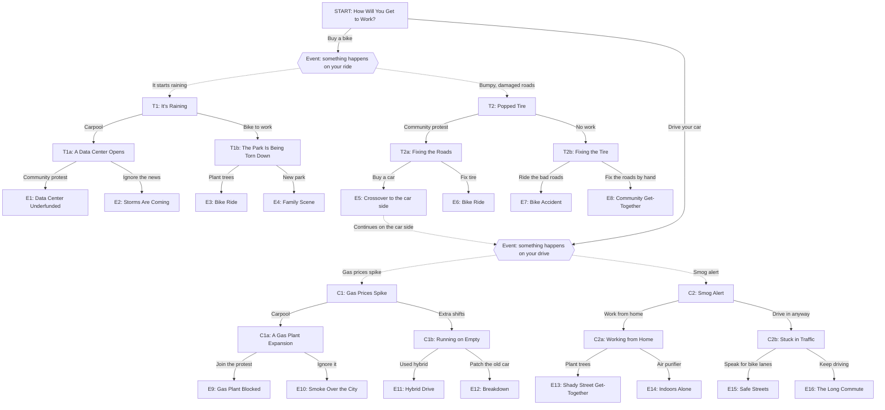

# Our Choices, Our Future

**Individual-action climate change game decision tree**

This is a branching narrative game. The player is an ordinary young adult, not a mayor, president, CEO, or other leader. Every decision is something one person can realistically do.

The tree has two sides, chosen by the first decision:

- **Bike side (left):** redesigned. There is no bus. After you buy a bike, a random event happens, and then you make two more decisions. One path (buying a car) crosses over to the car side.
- **Car side (right):** after you start driving, a random event happens, and then you make two more decisions.

**Four stats:** Economy, Wellbeing, Environment, Social Equity.

## Game setup

**Premise.** You are a young adult living in a city experiencing rising living costs, extreme weather, damaged roads, and unequal access to resources. Your daily choices affect your own future and the people around you.

**Starting stats:** Economy = 50, Wellbeing = 50, Environment = 50, Social Equity = 50. Stat range: 0–100.

| Stat | Meaning |
|---|---|
| Economy | Personal financial security and local economic resilience. |
| Wellbeing | Health, safety, comfort, and quality of life. |
| Environment | Personal environmental impact and health of the immediate surroundings. |
| Social Equity | Fair access to resources, opportunities, protection, and assistance in the community. |

> **Important:** Stat effects are illustrative game-balance numbers, not quantitative scientific predictions. A positive Social Equity score represents a decision that makes access or benefits more inclusive; it does not mean one person can eliminate structural inequality.

### Scenes, events, and endings

- A **scene** asks the player to choose between two options.
- An **event** is something that happens to the player. There is no choice: the game picks one outcome at random. Events have no stat effects.
- An **ending** is the final cinematic for a path. Two paths can share an ending scene (E3 and E6 both show the Bike Ride), but each path keeps its own final scores.
- A **crossover** sends the player to the other side of the tree instead of an ending (E5).

## Branching map

Solid lines are choices. Dotted lines are random events or crossovers.



## Decision scenes and effects

In all tables, **Eco = Economy**, **Well = Wellbeing**, **Env = Environment**, **Eq = Social Equity**. A plus sign increases a stat; a minus sign decreases it. Effects accumulate over the path.

### Decision 1 — Starting choice

#### Scene `START` — How Will You Get to Work?

You recently started a new job across town. You need a reliable commute, but traffic congestion and air pollution are growing problems. You must decide how to travel each day.

| Choice | Action | Eco | Well | Env | Eq | Next |
|---|---|---:|---:|---:|---:|---|
| **B** | Buy a bike | -3 | +3 | +8 | +1 | `EV` (event) |
| **C** | Drive your own car | -6 | +5 | -8 | -2 | `CEV` (event) |

**Consequences:**

- **B → `EV`:** Biking is cheap to run and produces no emissions, but you are exposed to the weather and the state of the roads.
- **C → `CEV`:** Driving is convenient and saves time, but it's expensive and leaves you exposed to gas prices and polluted air.

## Bike side

### Event `EV` — Something Happens on Your Ride

No choice. The game picks one outcome at random, with equal chances.

| Outcome | What happens | Next |
|---|---|---|
| **Rain** | A heavy rainstorm rolls in on your way to work. Storms like this are becoming more frequent and intense as the climate warms. | `T1` |
| **Bumpy roads** | Holes and bumpy, damaged roads make every ride rough. One day, your tire pops. | `T2` |

### Decision 2

#### Scene `T1` — It's Raining

It's pouring, and you still have to get to work.

| Choice | Action | Eco | Well | Env | Eq | Next |
|---|---|---:|---:|---:|---:|---|
| **T1a** | Carpool with a coworker | 0 | +2 | -2 | +3 | `T1a` |
| **T1b** | Bike to work anyway | +2 | -3 | +5 | 0 | `T1b` |

**Consequences:**

- **T1a → `T1a`:** You stay dry. On the drive, your coworker mentions that a huge data center is opening on the edge of town.
- **T1b → `T1b`:** You arrive soaked. On the way, you pass a sign: the city is tearing down the neighborhood park to build apartments.

#### Scene `T2` — Popped Tire

Holes in the road finally pop your bike tire. Neighbors who bike and walk deal with the same damaged roads.

| Choice | Action | Eco | Well | Env | Eq | Next |
|---|---|---:|---:|---:|---:|---|
| **T2a** | Join a community protest to get the roads fixed | -1 | +1 | +3 | +6 | `T2a` |
| **T2b** | Skip work for the day | -6 | +1 | 0 | -1 | `T2b` |

**Consequences:**

- **T2a → `T2a`:** The city agrees to repair the roads. Your bike still needs a new tire, though.
- **T2b → `T2b`:** You lose a day's pay, and your tire is still flat.

### Decision 3

#### Scene `T1a` — A Data Center Opens

A huge data center is opening nearby. It will use enormous amounts of electricity and water, much of the power from fossil fuels.

| Choice | Action | Eco | Well | Env | Eq | Next |
|---|---|---:|---:|---:|---:|---|
| **1** | Join a community protest against the data center | -2 | +2 | +8 | +7 | `E1` |
| **2** | Ignore the news | +1 | 0 | -7 | -3 | `E2` |

**Consequences:**

- **1 → `E1`:** The protest grows, and the project loses its funding.
- **2 → `E2`:** The data center opens and runs around the clock.

#### Scene `T1b` — The Park Is Being Torn Down

The city is forcing the neighborhood park to be destroyed to build new apartments. The park's trees keep the area cool and soak up rainwater.

| Choice | Action | Eco | Well | Env | Eq | Next |
|---|---|---:|---:|---:|---:|---|
| **1** | Plant trees and protect what nature you can | -1 | +4 | +7 | +5 | `E3` |
| **2** | Push for a new park in the building plans | -2 | +6 | +4 | +4 | `E4` |

**Consequences:**

- **1 → `E3`:** New trees line your street and your route to work.
- **2 → `E4`:** The plans change to include a new park.

#### Scene `T2a` — Fixing the Roads

The city is repairing the roads after the protest, but your bike still has a flat.

| Choice | Action | Eco | Well | Env | Eq | Next |
|---|---|---:|---:|---:|---:|---|
| **1** | Buy a car | -6 | +3 | -7 | -1 | `E5` (crossover) |
| **2** | Fix your tire and keep biking | -1 | +2 | +4 | +1 | `E6` |

**Consequences:**

- **1 → `E5`:** You buy a car, and the story continues on the car side of the tree.
- **2 → `E6`:** With a new tire and smooth roads, biking is easy again.

#### Scene `T2b` — Fixing the Tire

You patch the tire, but the roads are still full of holes.

| Choice | Action | Eco | Well | Env | Eq | Next |
|---|---|---:|---:|---:|---:|---|
| **1** | Keep riding on the bad roads | +1 | -6 | +2 | 0 | `E7` |
| **2** | Fix the roads by hand with your neighbors | -1 | +3 | +3 | +7 | `E8` |

**Consequences:**

- **1 → `E7`:** A hidden pothole throws you off your bike.
- **2 → `E8`:** Neighbors show up with tools, and the street turns into a gathering.

## Car side

### Event `CEV` — Something Happens on Your Drive

No choice. The game picks one outcome at random, with equal chances. Players who buy a car on the bike side (E5) also enter the car side here, keeping their stats.

| Outcome | What happens | Next |
|---|---|---|
| **Gas prices spike** | A hurricane shuts down Gulf Coast refineries, and gas prices jump overnight. | `C1` |
| **Smog alert** | Wildfire smoke and traffic exhaust trigger an air-quality alert. The city asks people to drive less. | `C2` |

### Decision 2

#### Scene `C1` — Gas Prices Spike

Filling your tank now costs far more, and your coworkers are struggling with the same costs.

| Choice | Action | Eco | Well | Env | Eq | Next |
|---|---|---:|---:|---:|---:|---|
| **C1a** | Start a carpool with coworkers | +5 | -1 | +5 | +4 | `C1a` |
| **C1b** | Pick up extra shifts to pay for gas | +4 | -6 | -2 | -1 | `C1b` |

**Consequences:**

- **C1a → `C1a`:** You split the cost. On the drive, your carpool friends mention that the utility wants to expand the gas power plant near your neighborhood.
- **C1b → `C1b`:** You cover the cost of gas, but the long hours wear you down, and your old car starts making strange noises.

#### Scene `C2` — Smog Alert

The sky is hazy, and the air smells like smoke. The city asks people to stay off the roads if they can.

| Choice | Action | Eco | Well | Env | Eq | Next |
|---|---|---:|---:|---:|---:|---|
| **C2a** | Work from home on alert days | 0 | +3 | +5 | +1 | `C2a` |
| **C2b** | Drive in anyway | +1 | -3 | -5 | -1 | `C2b` |

**Consequences:**

- **C2a → `C2a`:** You skip the commute. At home, you notice how few trees your block has and how hot it gets.
- **C2b → `C2b`:** You get stuck in a traffic jam that barely moves.

### Decision 3

#### Scene `C1a` — A Gas Plant Expansion

The utility plans to expand the gas power plant near your neighborhood. Residents nearby already breathe polluted air.

| Choice | Action | Eco | Well | Env | Eq | Next |
|---|---|---:|---:|---:|---:|---|
| **1** | Join the community protest against the expansion | -2 | +2 | +8 | +7 | `E9` |
| **2** | Ignore it | +1 | -1 | -7 | -3 | `E10` |

**Consequences:**

- **1 → `E9`:** The protest grows, and the utility drops the expansion.
- **2 → `E10`:** The expansion goes ahead, and the plant runs harder than ever.

#### Scene `C1b` — Running on Empty

The extra shifts have left you exhausted, and your old car needs a costly repair.

| Choice | Action | Eco | Well | Env | Eq | Next |
|---|---|---:|---:|---:|---:|---|
| **1** | Trade it in for a used hybrid | -5 | +3 | +6 | 0 | `E11` |
| **2** | Keep patching the old car | -3 | -5 | -4 | 0 | `E12` |

**Consequences:**

- **1 → `E11`:** Your new car uses far less gas.
- **2 → `E12`:** The repair holds for a while.

#### Scene `C2a` — Working from Home

Home on smog days, you notice your street has almost no shade and heats up fast.

| Choice | Action | Eco | Well | Env | Eq | Next |
|---|---|---:|---:|---:|---:|---|
| **1** | Organize a tree planting with your neighbors | -1 | +4 | +7 | +6 | `E13` |
| **2** | Buy an air purifier and stay inside | -4 | +2 | -1 | -2 | `E14` |

**Consequences:**

- **1 → `E13`:** Neighbors show up with shovels and young trees.
- **2 → `E14`:** The air inside is clean, but you stay shut in.

#### Scene `C2b` — Stuck in Traffic

Traffic barely moves. The city is deciding whether to widen the highway or build protected bike lanes.

| Choice | Action | Eco | Well | Env | Eq | Next |
|---|---|---:|---:|---:|---:|---|
| **1** | Speak at the city meeting for protected bike lanes | -1 | +3 | +7 | +6 | `E15` |
| **2** | Keep driving and wait it out | +2 | -4 | -6 | -2 | `E16` |

**Consequences:**

- **1 → `E15`:** The city chooses bike lanes.
- **2 → `E16`:** The city widens the highway, and traffic soon fills it again.

## Endings with computed final scores

The final score for each path is **50 + the effects from every choice on that path**. Events add nothing. Endings are tied to the path, not to score thresholds.

| Ending | Title | Path | Eco | Well | Env | Eq |
|---|---|---|---:|---:|---:|---:|
| **E1** | Data Center Underfunded | `START:B → EV:Rain → T1:T1a → T1a:1` | 45 | 57 | 64 | 61 |
| **E2** | Storms Are Coming | `START:B → EV:Rain → T1:T1a → T1a:2` | 48 | 55 | 49 | 51 |
| **E3** | Bike Ride | `START:B → EV:Rain → T1:T1b → T1b:1` | 48 | 54 | 70 | 56 |
| **E4** | Family Scene | `START:B → EV:Rain → T1:T1b → T1b:2` | 47 | 56 | 67 | 55 |
| **E5** | Crossover to the car side | `START:B → EV:Bumpy roads → T2:T2a → T2a:1` | 40 | 57 | 54 | 56 |
| **E6** | Bike Ride | `START:B → EV:Bumpy roads → T2:T2a → T2a:2` | 45 | 56 | 65 | 58 |
| **E7** | Bike Accident | `START:B → EV:Bumpy roads → T2:T2b → T2b:1` | 42 | 48 | 60 | 50 |
| **E8** | Community Get-Together | `START:B → EV:Bumpy roads → T2:T2b → T2b:2` | 40 | 57 | 61 | 57 |
| **E9** | Gas Plant Blocked | `START:C → CEV:Gas prices → C1:C1a → C1a:1` | 47 | 56 | 55 | 59 |
| **E10** | Smoke Over the City | `START:C → CEV:Gas prices → C1:C1a → C1a:2` | 50 | 53 | 40 | 49 |
| **E11** | Hybrid Drive | `START:C → CEV:Gas prices → C1:C1b → C1b:1` | 43 | 52 | 46 | 47 |
| **E12** | Breakdown | `START:C → CEV:Gas prices → C1:C1b → C1b:2` | 45 | 44 | 36 | 47 |
| **E13** | Shady Street Get-Together | `START:C → CEV:Smog alert → C2:C2a → C2a:1` | 43 | 62 | 54 | 55 |
| **E14** | Indoors Alone | `START:C → CEV:Smog alert → C2:C2a → C2a:2` | 40 | 60 | 46 | 47 |
| **E15** | Safe Streets | `START:C → CEV:Smog alert → C2:C2b → C2b:1` | 44 | 55 | 44 | 53 |
| **E16** | The Long Commute | `START:C → CEV:Smog alert → C2:C2b → C2b:2` | 47 | 48 | 31 | 45 |

E5 is not an ending. The player enters the car side at the `CEV` event, and their bike-side scores carry over as starting stats. From there, their final scores are their E5 scores plus the car-side effects (the table shows car-side scores for players who started by driving).

### Ending descriptions

- **E1 — Data Center Underfunded:** The protest works. The data center loses its funding, and the town's power and water stay with the people who live there.
- **E2 — Storms Are Coming:** The data center opens and burns through power day and night. Dark clouds gather as the storms keep getting worse.
- **E3 — Bike Ride:** A cinematic ride to work through the trees you helped plant.
- **E4 — Family Scene:** A cinematic scene of your family in the new park, happy and together.
- **E5 — Crossover:** You buy a car, and the story continues on the car side of the tree.
- **E6 — Bike Ride:** The same cinematic Bike Ride as E3, this time on the newly repaired roads.
- **E7 — Bike Accident:** The bad roads cause a crash. You're hurt, and the roads are still dangerous for everyone.
- **E8 — Community Get-Together:** Fixing the roads together brings the neighborhood closer.
- **E9 — Gas Plant Blocked:** The protest works. The utility drops the expansion, and the neighborhood's air starts to clear.
- **E10 — Smoke Over the City:** The bigger plant runs day and night, and a gray haze settles over the city.
- **E11 — Hybrid Drive:** A cinematic drive in your new hybrid, burning far less gas than before.
- **E12 — Breakdown:** The old car finally dies on the highway in the heat, and the repair bills keep coming.
- **E13 — Shady Street Get-Together:** A cinematic scene of neighbors planting trees together, with a shady, cooler street to show for it.
- **E14 — Indoors Alone:** You breathe clean air inside, but the street outside stays hot and bare.
- **E15 — Safe Streets:** A cinematic scene of families biking on the new protected lanes.
- **E16 — The Long Commute:** The wider highway fills with cars again, and you sit in traffic under a smoggy sky.

### Example scene data (JSON)

A choice scene and an event:

```json
{
  "id": "T2",
  "title": "Popped Tire",
  "description": "Holes in the road finally pop your bike tire.",
  "choices": [
    {
      "text": "Join a community protest to get the roads fixed",
      "effects": {"economy": -1, "wellbeing": 1, "environment": 3, "socialEquity": 6},
      "nextScene": "T2a"
    },
    {
      "text": "Skip work for the day",
      "effects": {"economy": -6, "wellbeing": 1, "environment": 0, "socialEquity": -1},
      "nextScene": "T2b"
    }
  ]
}
```

```json
{
  "id": "EV",
  "type": "event",
  "outcomes": [
    {"text": "A heavy rainstorm rolls in on your way to work.", "weight": 1, "nextScene": "T1"},
    {"text": "Holes in the road make every ride rough.", "weight": 1, "nextScene": "T2"}
  ]
}
```

### Design and accessibility considerations

- Visually update the neighborhood or character after important choices (rain, damaged roads, the data center, the park, new trees, smog, the gas plant, traffic).
- Show all four meters after each choice, with readable text and symbols in addition to color.
- Present personal decisions as **trade-offs**, not moral judgments. Options such as driving or skipping work may be necessities depending on ability, safety, access, or income.
- Keep the central message realistic: individual actions can influence personal wellbeing and mutual aid, while large-scale climate change also requires collective and systemic solutions.

## Validation

**Bike side**

- 1 event (`EV`) with 2 equally likely outcomes.
- 6 choice scenes: `T1`, `T2`, `T1a`, `T1b`, `T2a`, `T2b`, with exactly 2 choices each.
- 8 paths: 7 reach an ending, and 1 (E5) crosses over to the car side.
- Every bike path has 3 decisions: `START`, one of `T1`/`T2`, and one final scene.

**Car side**

- 1 event (`CEV`) with 2 equally likely outcomes.
- 6 choice scenes: `C1`, `C2`, `C1a`, `C1b`, `C2a`, `C2b`, with exactly 2 choices each.
- 8 paths, each reaching an ending (E9–E16).
- Every car path has 3 decisions: `START`, one of `C1`/`C2`, and one final scene.
- E5 crossover players enter at `CEV` and make 2 more decisions, for 5 in total.
